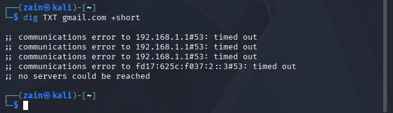
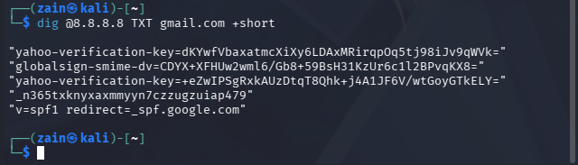
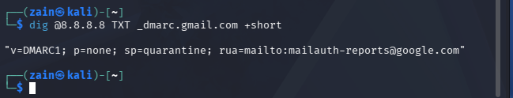
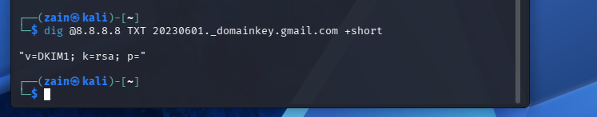
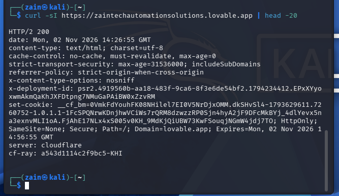
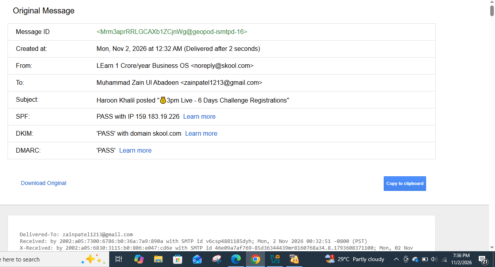

# Project 10 — Email Security and Phishing Audit

**Cyber Projects Sprint · Zain Tech Automation Solutions**

A hands-on email-security audit: the anti-spoofing records (SPF, DKIM, DMARC) of a
major mail domain were checked with `dig`, the response headers of my own company
website were audited with `curl`, and a real incoming email was dissected with
Gmail's "Show original" to read its authentication results and delivery path.
The project closes with a one-page Staff Phishing Guide.

> **Scope & ethics:** All checks are public DNS lookups, my own website, and an
> email from my own inbox. Nothing was sent, spoofed, or tested against anyone
> else's mailbox.

## The three records, in one line each

- **SPF** — the domain's public list of servers allowed to send mail for it.
- **DKIM** — a digital signature ("seal") on each mail; the public key in DNS lets
  the receiver verify the mail really came from the domain and was not altered.
- **DMARC** — the domain owner's instruction for failed mail (report / quarantine /
  reject), and the rule that the visible "From" domain must match SPF/DKIM.

## Audit 1 — gmail.com email-security records

Commands (run from Kali; note the resolver point in Lab Notes below):

```bash
dig @8.8.8.8 TXT gmail.com +short
dig @8.8.8.8 TXT _dmarc.gmail.com +short
dig @8.8.8.8 TXT google._domainkey.gmail.com +short
dig @8.8.8.8 TXT 20230601._domainkey.gmail.com +short
```

### Results

| Record | Present? | Finding |
|---|---|---|
| SPF | ✅ Yes | `v=spf1 redirect=_spf.google.com` — Gmail delegates its sender list to `_spf.google.com` |
| DMARC | ✅ Yes | `v=DMARC1; p=none; sp=quarantine; rua=mailto:mailauth-reports@google.com` — present, but policy is **monitoring (`p=none`)**, not enforcement; subdomains are stricter (`sp=quarantine`) |
| DKIM (`google` selector) | ❌ No record | The textbook selector returns nothing |
| DKIM (`20230601` selector) | ⚠️ Record exists, **key revoked** | `v=DKIM1; k=rsa; p=` — an **empty `p=` means the public key has been withdrawn** |

**DKIM finding explained:** a DKIM record lives under a *selector* chosen by the
sender, and senders rotate keys over time. Gmail's older `20230601` selector still
resolves, but its key has been revoked (emptied) — exactly what correct key hygiene
looks like. The currently used selector is not guessable from the domain; it is
read from a real message's `DKIM-Signature` header (`s=`), demonstrated in Audit 3.

## Audit 2 — Own website response headers

```bash
curl -sI https://zaintechautomationsolutions.lovable.app | head -20
```

| Header | Status | Note |
|---|---|---|
| `HTTP/2 200` | ✅ | Site live |
| `Strict-Transport-Security` (HSTS) | ✅ Present | `max-age=31536000; includeSubDomains` — forces HTTPS for a year |
| `X-Content-Type-Options: nosniff` | ✅ Present | Blocks MIME-type sniffing |
| `Referrer-Policy` | ✅ Present | `strict-origin-when-cross-origin` |
| Cookie flags (platform cookie) | ✅ | `HttpOnly; Secure` set |
| `Content-Security-Policy` | ❌ **Missing** | The header that whitelists where the page may load scripts/resources from — the main gap found |
| `Server` | ℹ️ `cloudflare` | Real origin stays hidden behind Cloudflare — good practice |

## Audit 3 — A real email's postmortem (Gmail "Show original")

Message examined: a notification from `noreply@skool.com` in my own inbox.

| Test | Result |
|---|---|
| SPF | **PASS** — sent from IP `159.183.19.226`, an authorised skool.com sender |
| DKIM | **PASS** — signature valid, domain `skool.com` |
| DMARC | **PASS** — From domain aligned with SPF/DKIM |

The `Received:` lines under the summary trace the message's journey server by
server — each hop stamps its own line, newest first. All three tests passing is
what a genuine, well-configured sender looks like; a phishing mail typically
fails at least one, or passes them for a *look-alike* domain — which is why the
guide below still matters.

## Staff Phishing Guide (deliverable)

**7 signs of a fake email — check before you click:**

1. **The domain is slightly off** — `skoo1.com`, `paypaI.com`, an extra word or letter.
2. **A strange link** — hover (or long-press) first; the real destination differs
   from the text you see.
3. **Money urgency** — "pay within 1 hour", "account will be closed today".
4. **A silent demand in the "boss's" name** — secrecy + gift cards / transfers =
   classic fraud pattern.
5. **Bad grammar and spelling** in a mail claiming to be from a big company.
6. **Attachment pressure** — invoices as `.zip`/`.html`/macro files you never expected.
7. **Reply-To is a different address** than the From — replies go to the attacker.

When in doubt: do not reply to the mail — contact the sender through a number or
channel you already trust.

## Recommendation — the road to `p=reject`

For a small company domain, DMARC enforcement is a journey, not a switch:

1. **Monitor** — publish SPF + DKIM and a DMARC record with `p=none`; read the
   `rua` reports to discover every legitimate sender (website, invoicing, marketing).
2. **Quarantine** — once all real senders pass, move to `p=quarantine` so failing
   mail lands in spam while you watch for mistakes.
3. **Reject** — finish at `p=reject`: receivers are instructed to refuse forged
   mail outright. Only do this after steps 1–2 prove nothing genuine will break.

## Screenshots

**The router's DNS never answered the VM — every dig in this audit was run against
a public resolver instead (see Lab Notes):**



**Gmail SPF — `v=spf1 redirect=_spf.google.com` (plus unrelated verification TXT records):**



**Gmail DMARC — `p=none` (monitoring), `sp=quarantine` for subdomains:**



**DKIM at selector `20230601` — record present, key revoked (`p=` empty):**



**Own website headers — HSTS and friends present, no Content-Security-Policy:**



**The real email's verdict — SPF PASS, DKIM PASS, DMARC PASS:**



## Lab notes

- From this VM, DNS queries to the home router (`192.168.1.1:53`) timed out even
  though ping to the router and to `8.8.8.8` both worked with 0% loss — the
  router's DNS service (an old dnsmasq, also seen in Project 1) does not answer
  this VM. All `dig` checks were therefore run with an explicit resolver
  (`dig @8.8.8.8 ...`), which is also the more reproducible audit method.
- `dig` on Kali comes from the `bind9-dnsutils` package.

---

*Part of the Cyber Projects Sprint by Zain — Zain Tech Automation Solutions ·
"Automate. Accelerate. Achieve." Educational audit work on public records and my
own systems only.*
